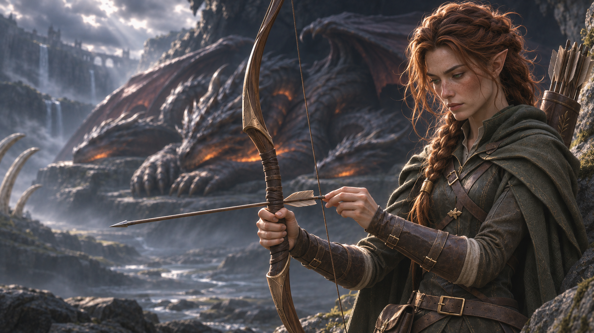
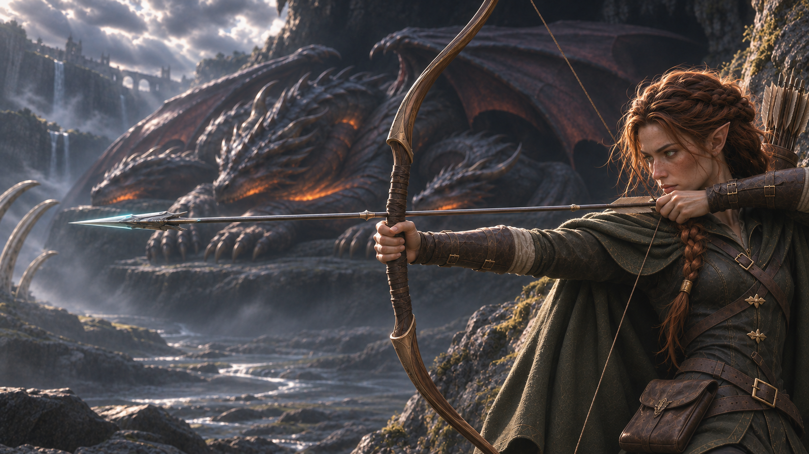
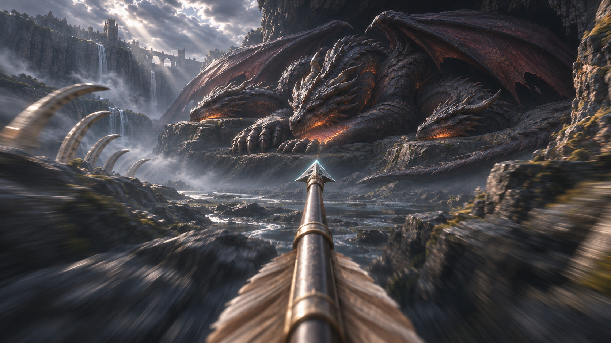
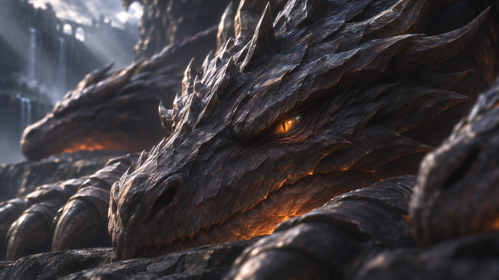
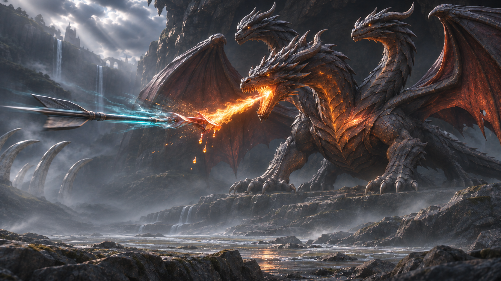
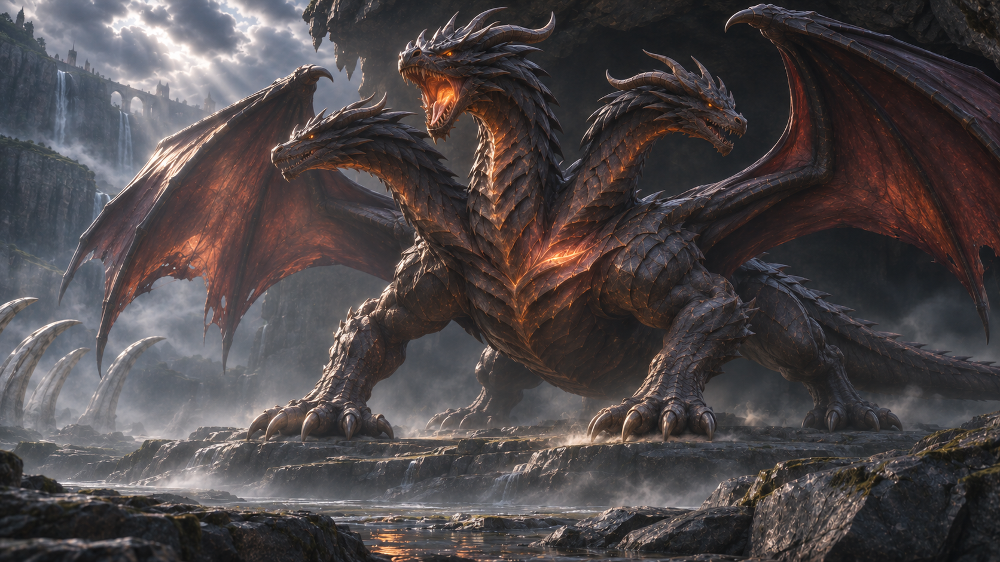
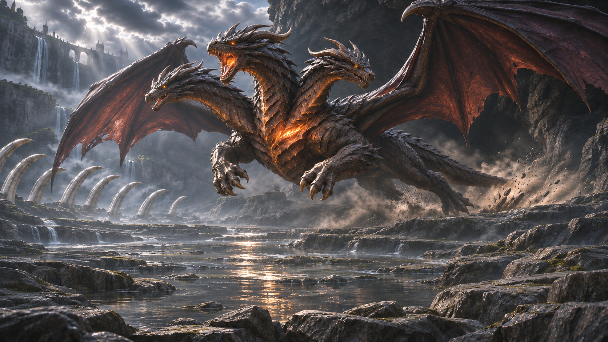
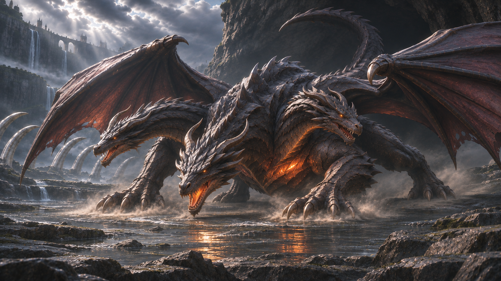
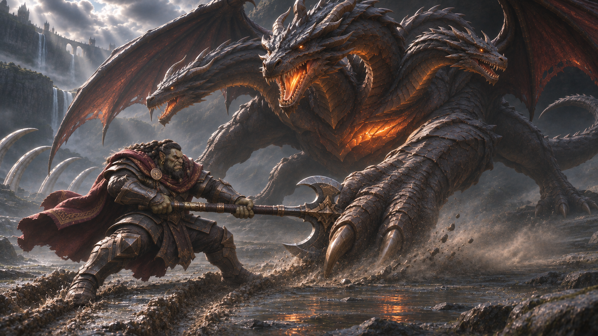
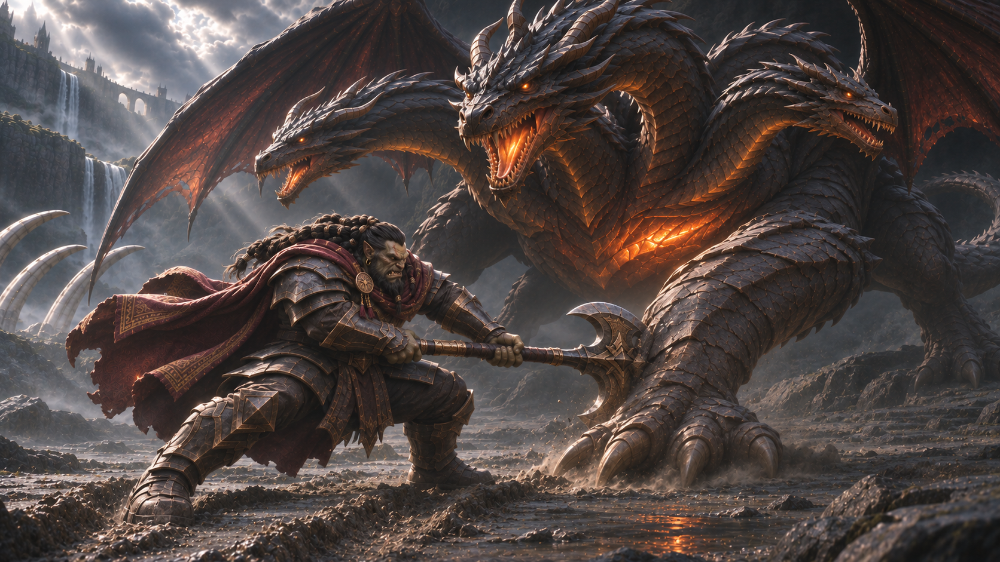

# Segment 02｜当前10张参考图 v6

每图为独立参考关键帧，不按十张等时播放。

### 01｜游侠搭弦

[当前重制提示词](ref-01.prompt.txt)

### 02｜穿透巨箭成形

[当前重制提示词](ref-02.prompt.txt)

### 03｜贴箭飞行

[当前重制提示词](ref-03.prompt.txt)

### 04｜恶龙猛然睁眼

[当前重制提示词](ref-04.prompt.txt)

### 05｜龙息熔箭

[当前重制提示词](ref-05.prompt.txt)

### 06｜巨龙起身咆哮

[当前重制提示词](ref-06.prompt.txt)

### 07｜后肢蓄力起跳

[当前重制提示词](ref-07.prompt.txt)

### 08｜前爪着地承重

[当前重制提示词](ref-08.prompt.txt)

### 09｜兽人抵住爪击

[当前重制提示词](ref-09.prompt.txt)

### 10｜借力劈开腕甲

[当前重制提示词](ref-10.prompt.txt)
