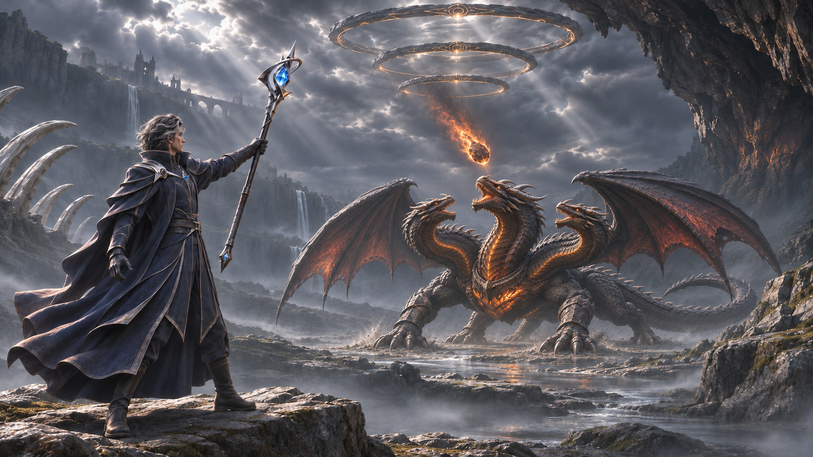
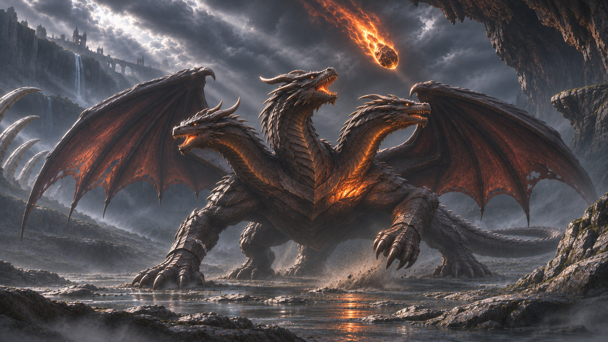
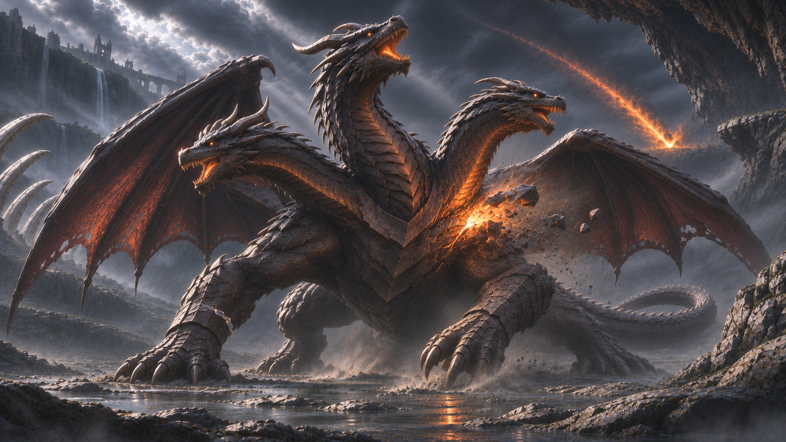
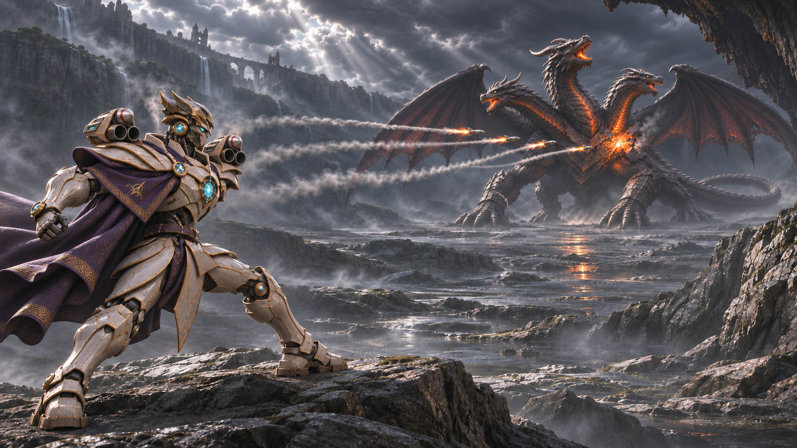
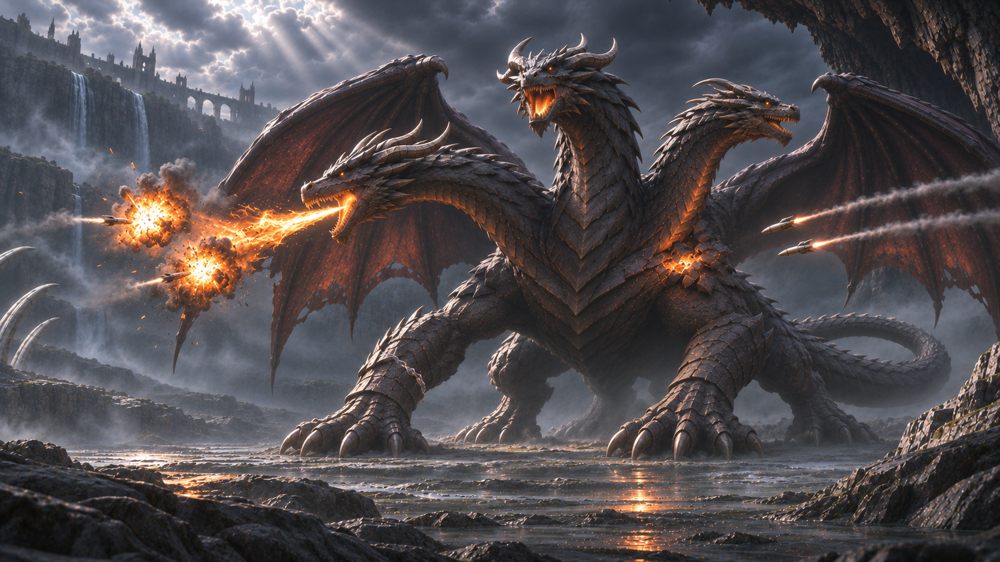
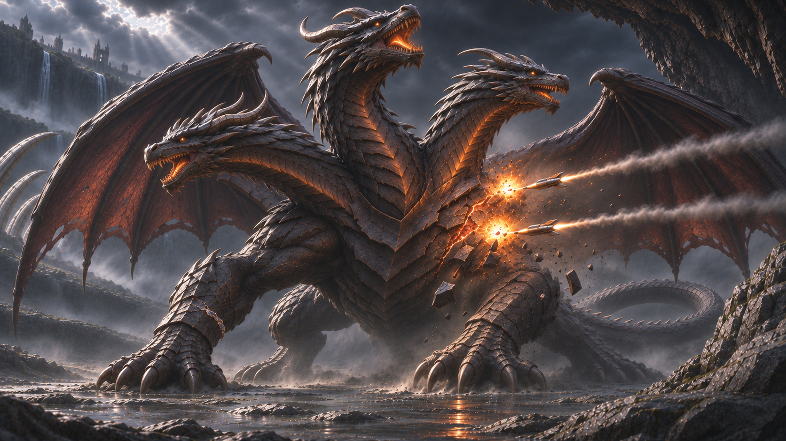
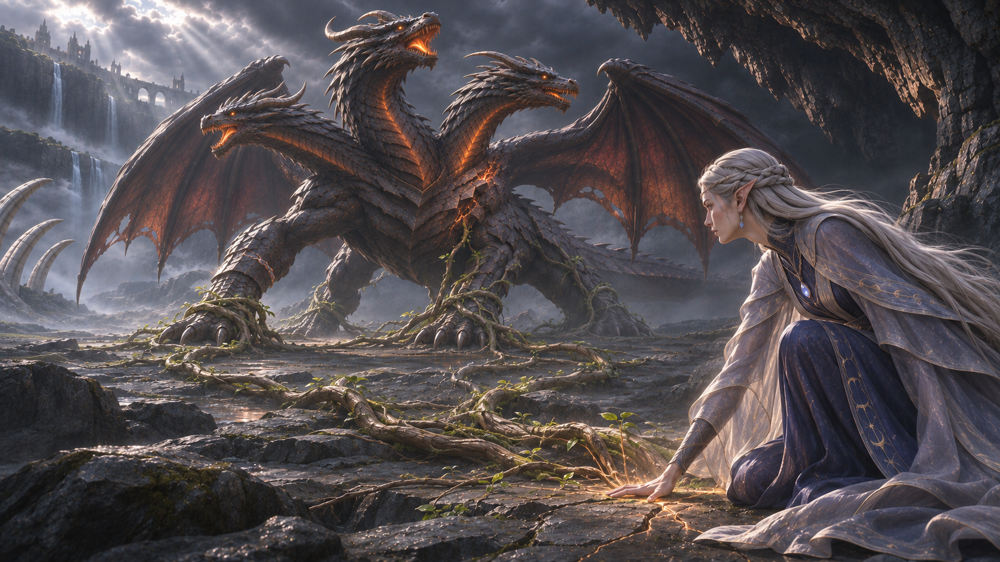
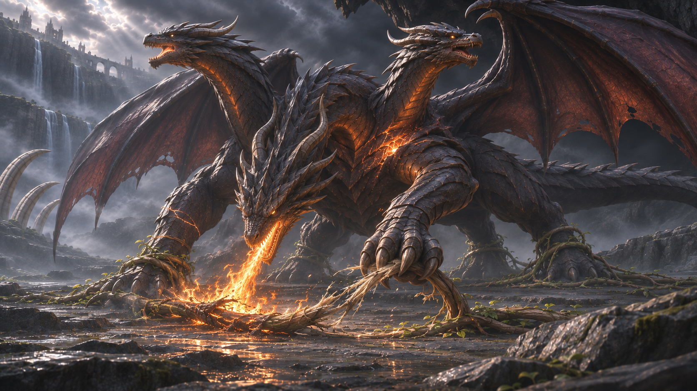
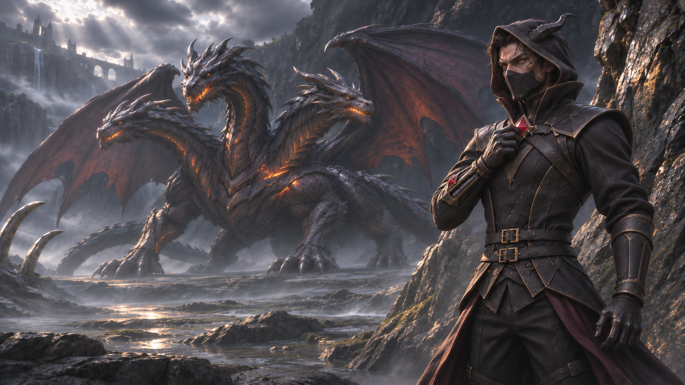
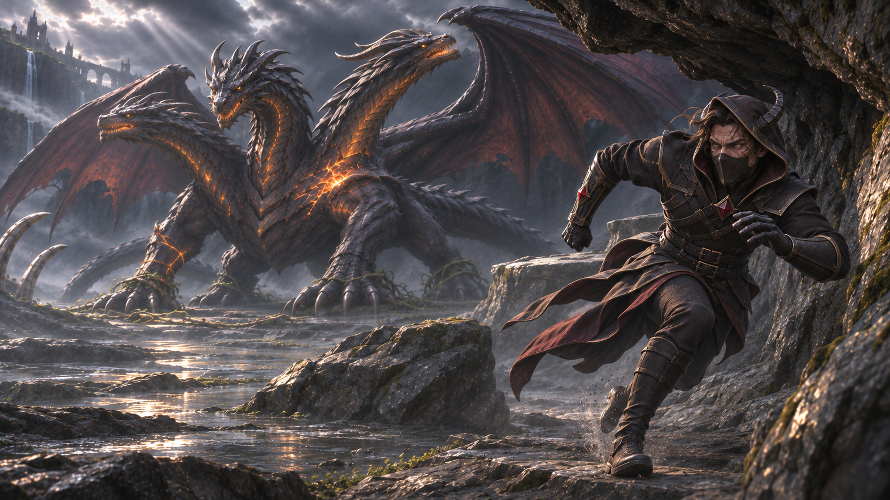

# Segment 03｜当前10张参考图 v6

每图为独立参考关键帧，不按十张等时播放。

### 01｜法师召唤陨石

[当前重制提示词](ref-01.prompt.txt)

### 02｜巨龙察觉天火

[当前重制提示词](ref-02.prompt.txt)

### 03｜陨石擦裂东颈肩

[当前重制提示词](ref-03.prompt.txt)

### 04｜机械体首轮四弹

[当前重制提示词](ref-04.prompt.txt)

### 05｜龙息截击两枚导弹

[当前重制提示词](ref-05.prompt.txt)

### 06｜余弹命中旧裂甲

[当前重制提示词](ref-06.prompt.txt)

### 07｜精灵藤蔓束足

[当前重制提示词](ref-07.prompt.txt)

### 08｜恶龙烧断第一圈藤

[当前重制提示词](ref-08.prompt.txt)

### 09｜龙裔变装成刺客

[当前重制提示词](ref-09.prompt.txt)

### 10｜刺客沿东壁绕行

[当前重制提示词](ref-10.prompt.txt)
