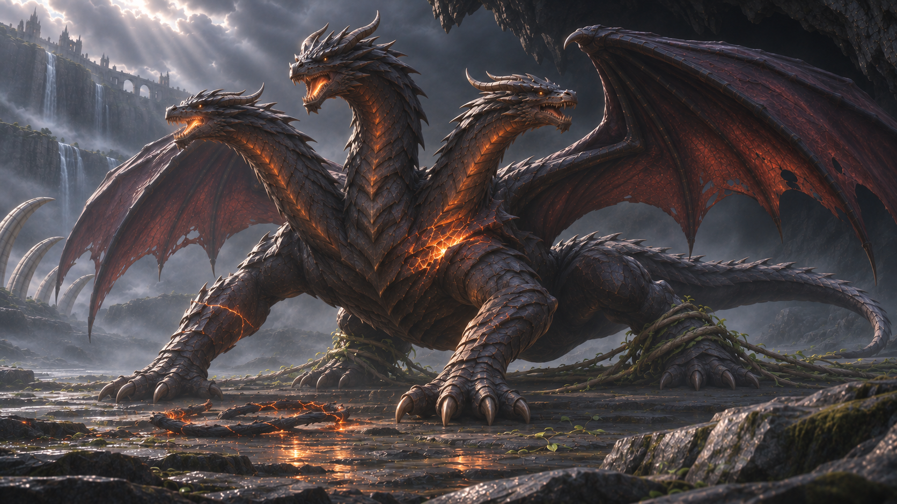
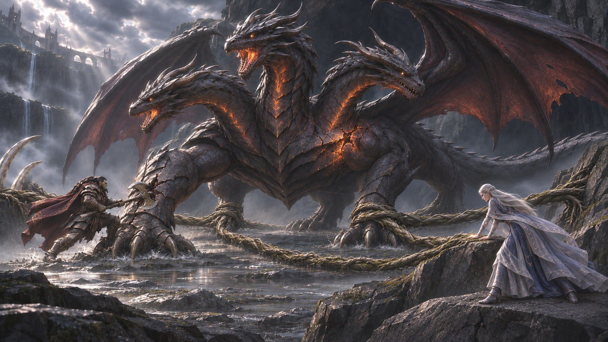
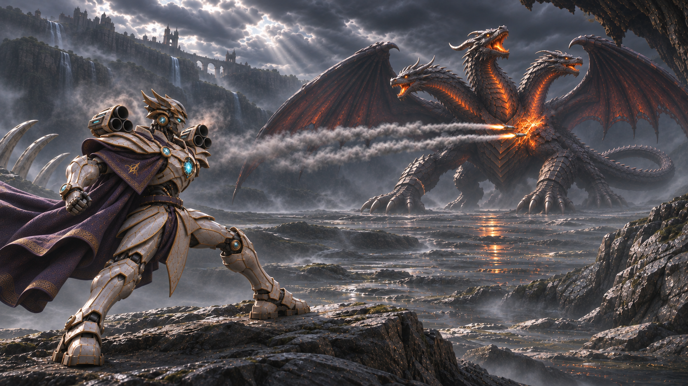
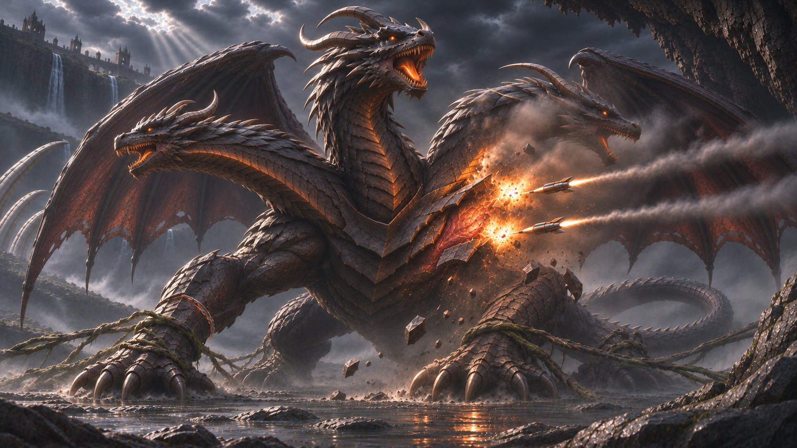
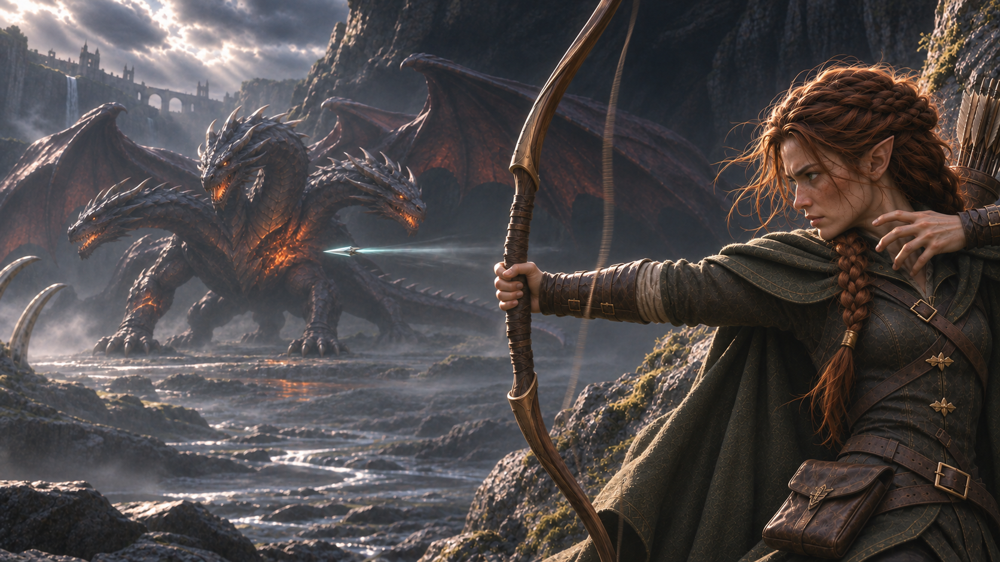
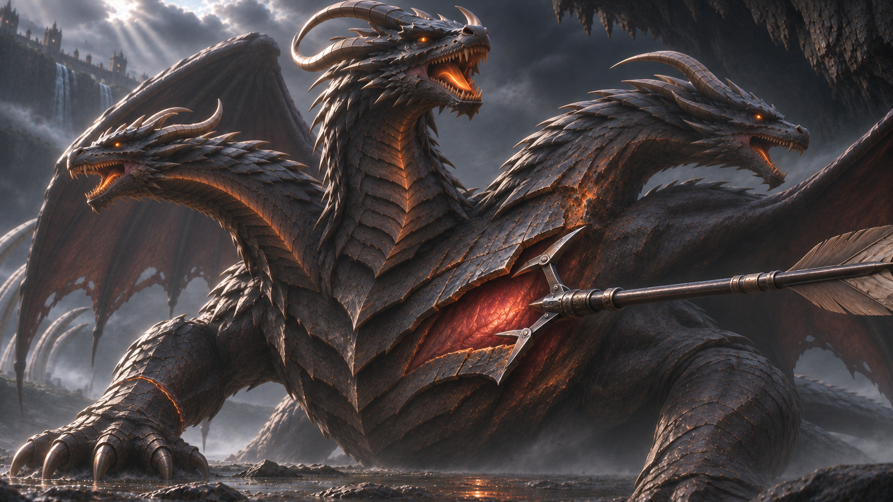
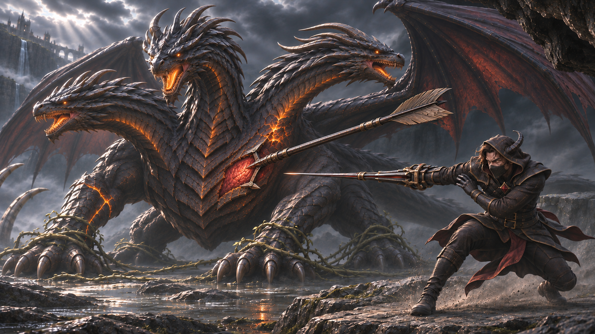
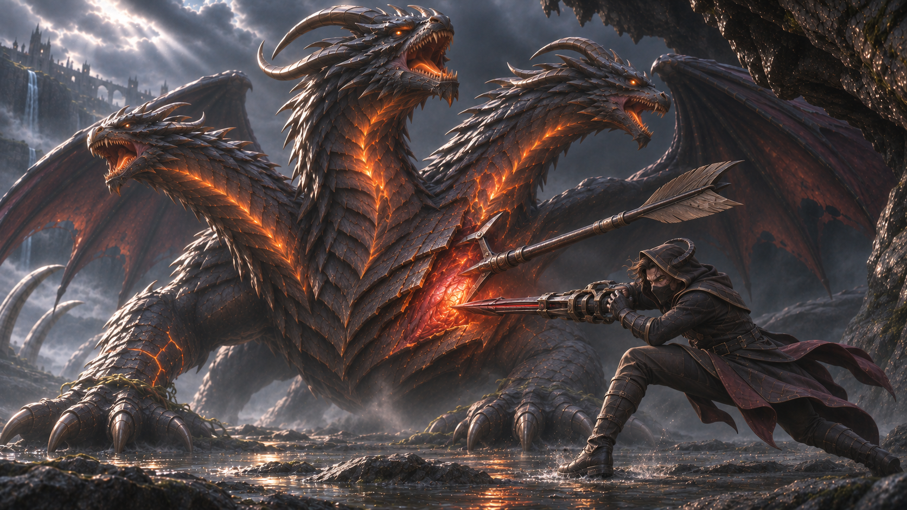
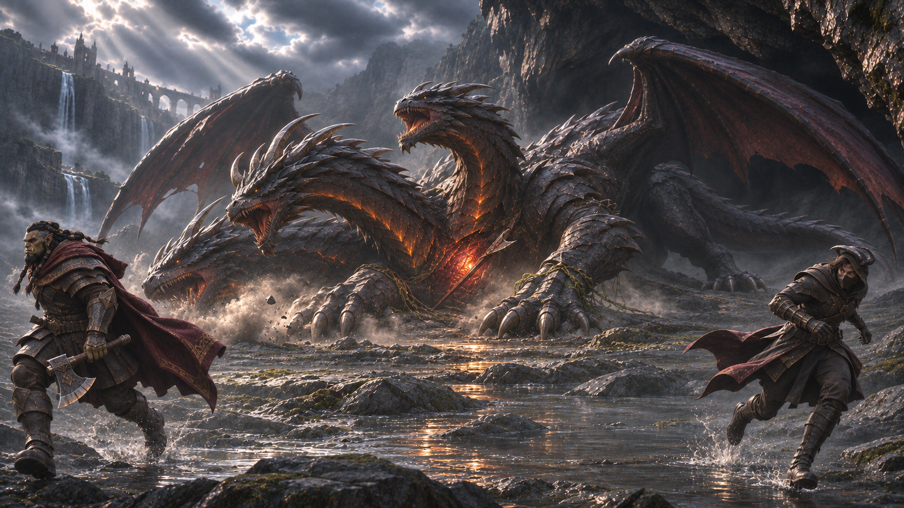
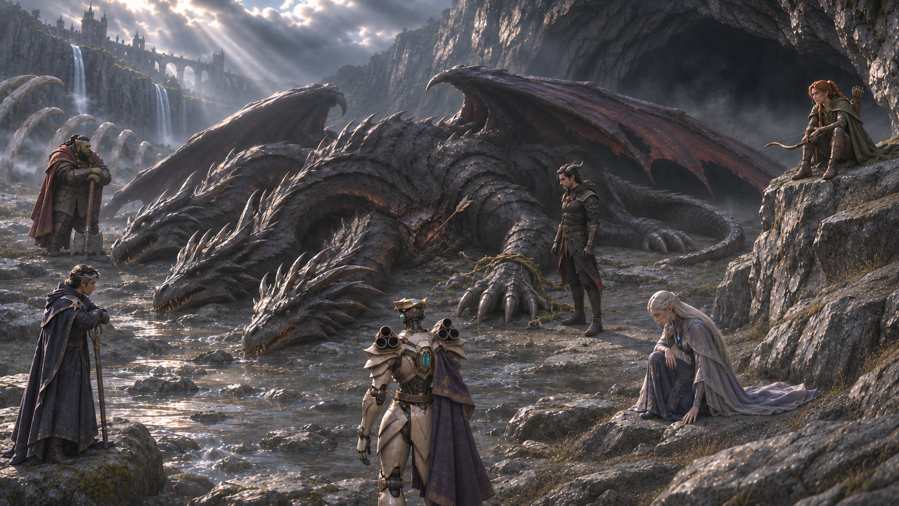

# Segment 04｜当前10张参考图 v6

每图为独立参考关键帧，不按十张等时播放。

### 01｜巨龙试图再起跳

[当前重制提示词](ref-01.prompt.txt)

### 02｜兽人与精灵共同牵制

[当前重制提示词](ref-02.prompt.txt)

### 03｜机械体最后两弹

[当前重制提示词](ref-03.prompt.txt)

### 04｜二轮爆压掀甲

[当前重制提示词](ref-04.prompt.txt)

### 05｜游侠第二次放箭

[当前重制提示词](ref-05.prompt.txt)

### 06｜巨箭楔开同一甲缝

[当前重制提示词](ref-06.prompt.txt)

### 07｜刺客短跃落地

[当前重制提示词](ref-07.prompt.txt)

### 08｜双手推进猎龙刺

[当前重制提示词](ref-08.prompt.txt)

### 09｜巨龙失力分次倒地

[当前重制提示词](ref-09.prompt.txt)

### 10｜六人确认生还

[当前重制提示词](ref-10.prompt.txt)
