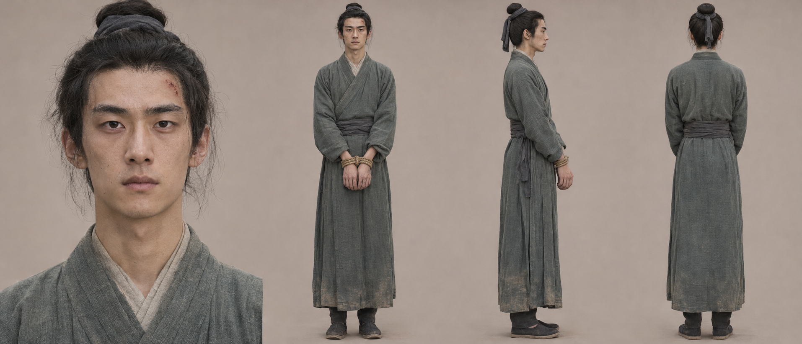
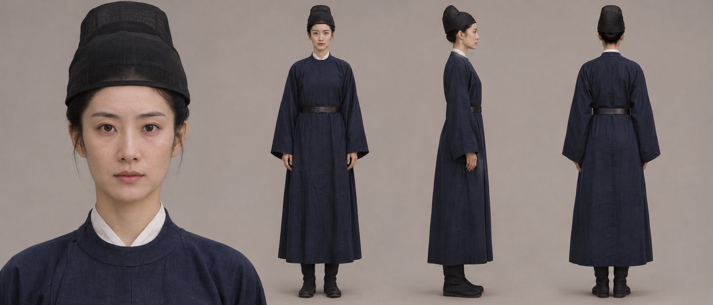
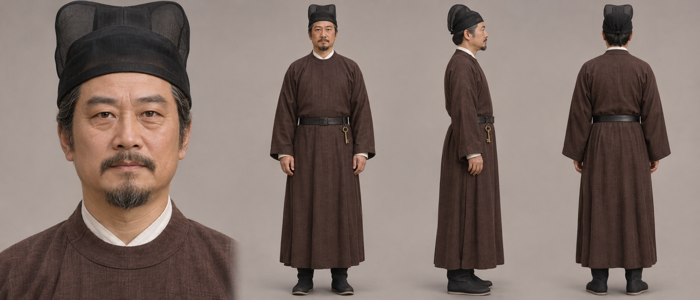
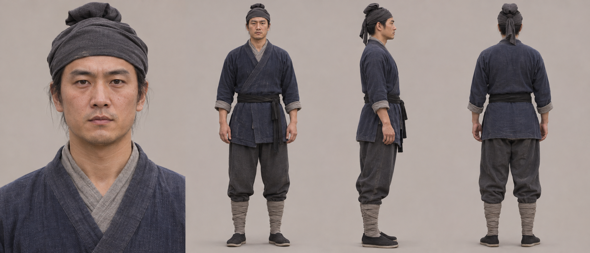
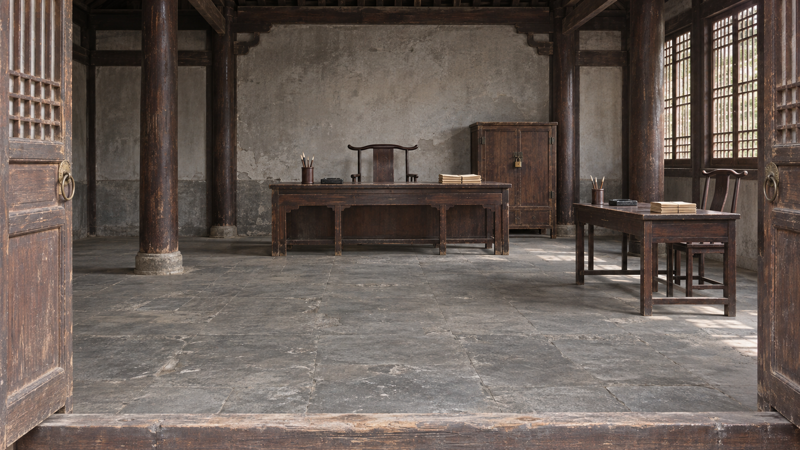
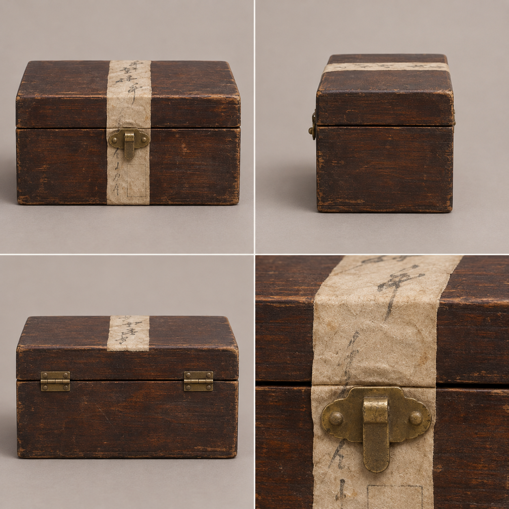

# 第1集参考图｜本机账号生成结果

六张均由Codex本机账号／GPT Image 2生成，每对象调用1次，全部succeeded。提示词见参考图方案v2-本机账号.md；自动尺寸，非承诺2K。六张均已实际打开检查，尚未由用户采用，未重生成。

## 陆砚｜1914×822

四视图与完整全身齐备，旧青衣、左额角伤处、正侧面腕绳可见；背面手腕被身体遮挡，不能凭本图验证背视绳结细节。头部特写上缘略紧。

## 沈知微｜1915×821

四视图齐备，深墨蓝官服、素帽与全身完整，无剧情场景和无关人物。

## 韩崇｜1914×822

四视图齐备，栗褐官服、腰间钥匙可见；视觉年龄偏成熟，胡须比文字“短髭”更浓，需用户判断是否保留。

## 衙役造型样本｜1914×822

四视图齐备，短褂、绑腿、空手状态符合用途。只作服装样本，剧中两名衙役不自动共用同脸。

## 县衙正堂｜1672×941

无人物。正案、侧案、带锁边柜、右侧木格窗与堂中通道可辨；可作空间候选。

## 封存印匣｜1254×1254

四格完整、匣子闭合。问题：前侧铜扣覆盖纸封条，封条的粘贴工序与扣件交叠关系不够可信；图中生成墨迹不能作为正确日期或签押。可看材质造型，但不宜直接作为关键验封证据特写的最终参考。修正会构成新提示词与新生成，须另行确认，不自动重试。
