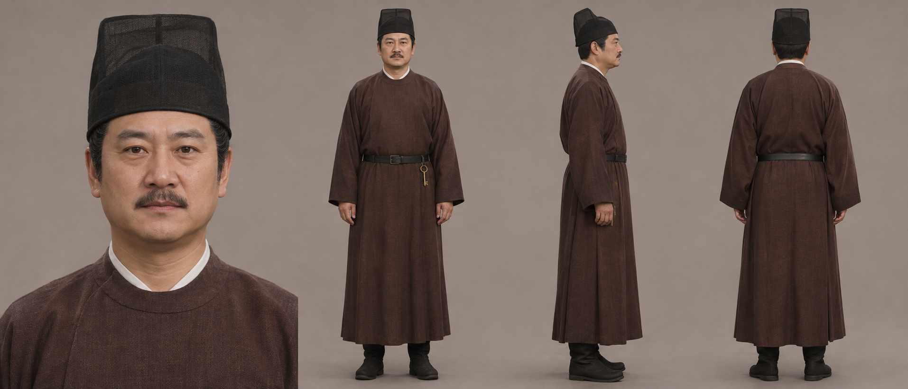
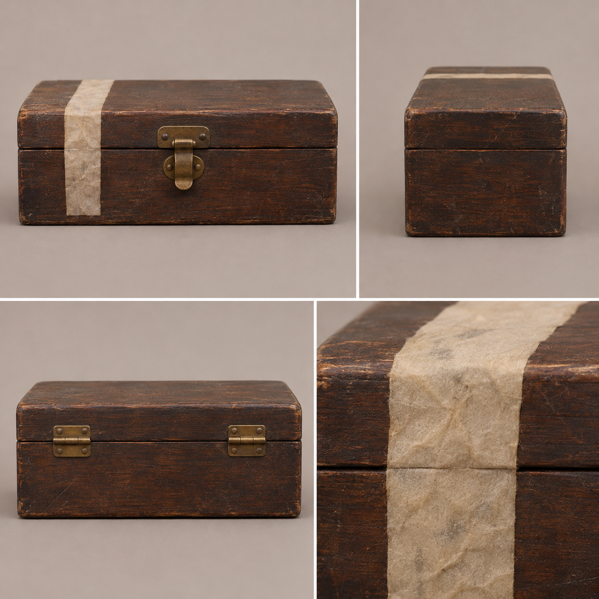

# 重生成C记录

用户明确批准问题图重生成方案C：韩崇与封存印匣各1次，共2次。完整提示词快照：问题图重生成方案C.md。模型均为providerId=codex、modelId=codexImage、size=auto、other={}，无图片或文本输入连线，文生图。算力消耗未知。

临执行回读：两节点提示词与方案C相同，输出为空。旧候选均保留，其余4张本轮不重做。

- C01韩崇，节点14c111cf-b74f-4bca-bf9b-db3e57fd7dc4，ratio=21:9，授权1次，已调用且succeeded。
- C02印匣，节点8b9e6aae-2927-442b-b090-943f4f9010e7，ratio=1:1，授权1次，已调用且succeeded。

## 真实结果与核验
两张均已实际read打开检查。韩崇1914×822：年龄感比旧版年轻，灰须与山羊胡去除，短黑髭、完整四视图与衣着一致，主要修正通过。印匣1254×1254：正面偏左纸条与中央铜扣已分离，盖身闭合，多视图无扣压纸错误；封条跨缝细节存在一道横向痕迹，静图无法确认是折痕还是裂口，不将其当作完整性鉴定。仍须后期加准确日期与签押，不用生成字迹当证据。

韩崇新候选：

印匣新候选：

用户授权的两次已用完，没有额外生成；旧图保留，新图未由用户明确采用。
