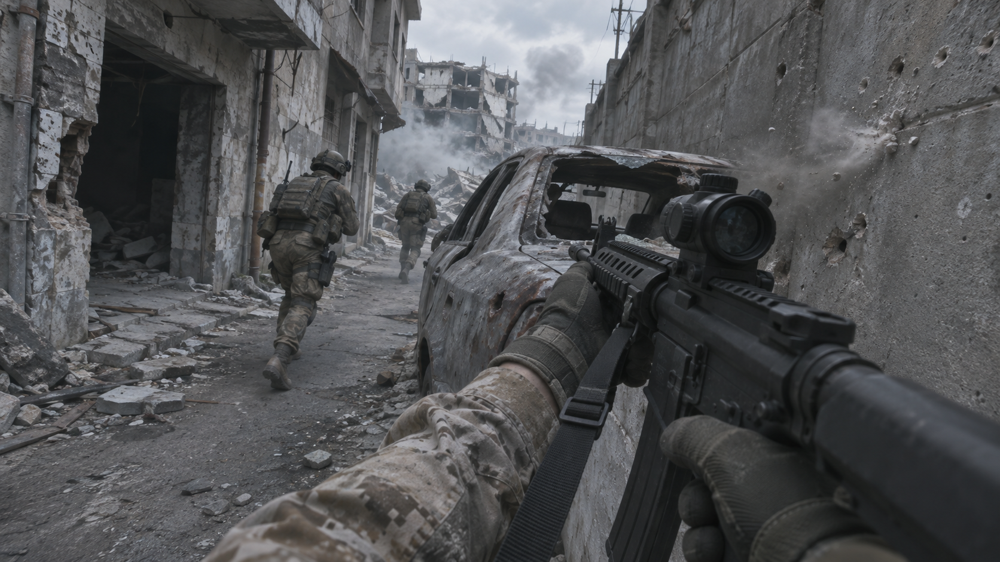
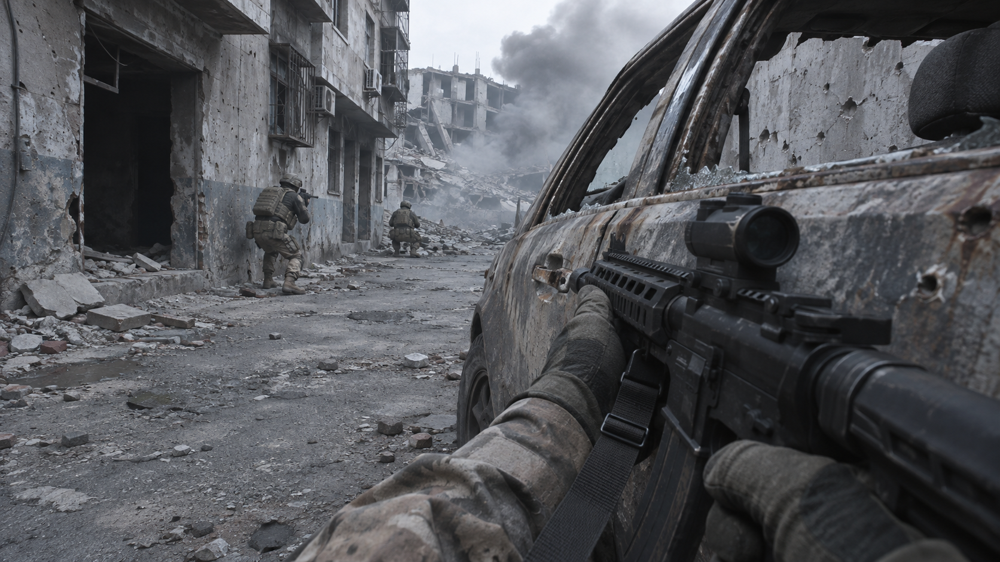
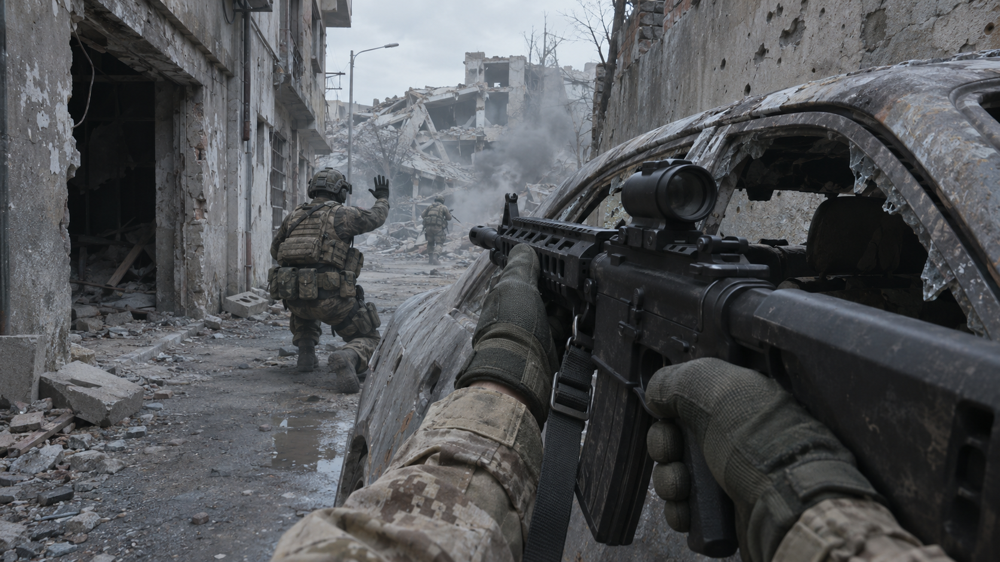
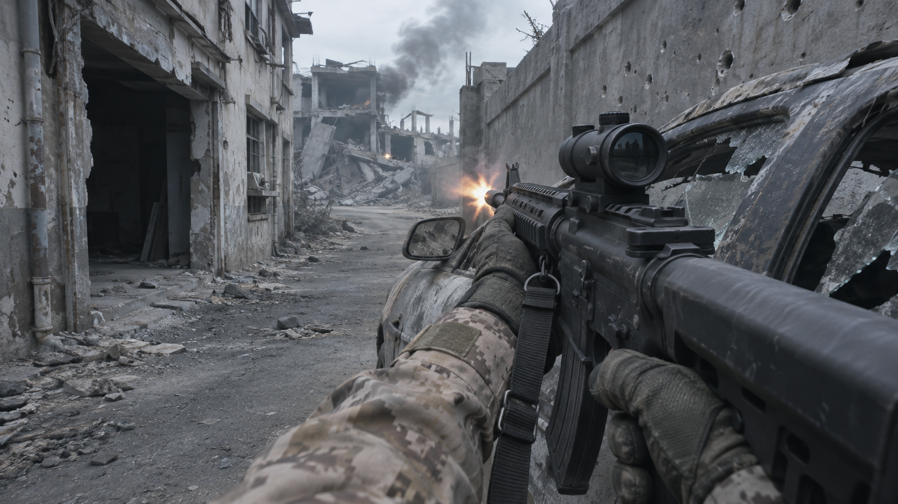
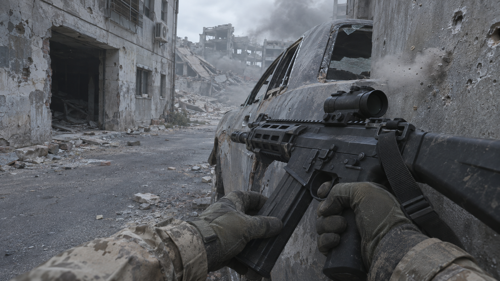
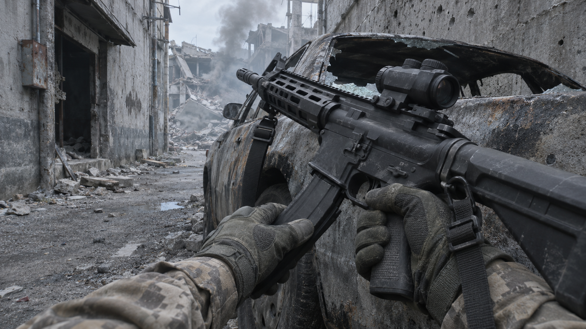
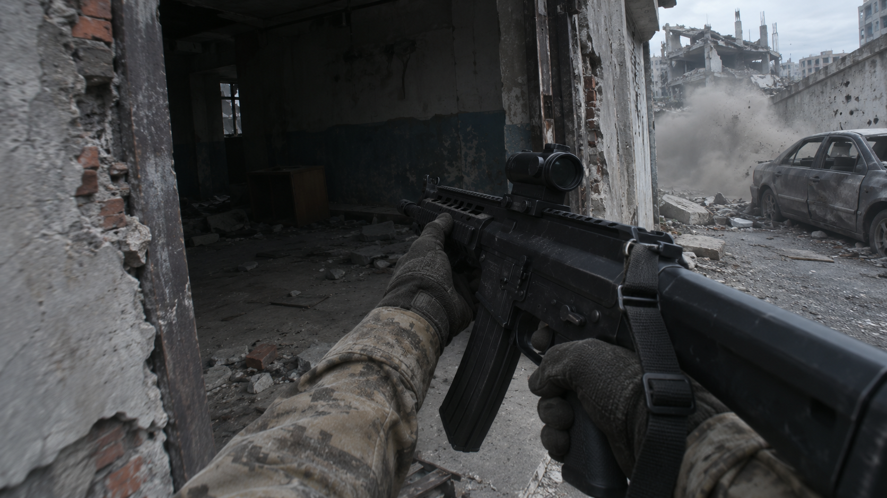

# 《最后一名突击手》第02、03段｜8张独立关键帧

## 状态与授权
已按批准方案每张生成1次，共8次，全部succeeded。模型：GPT Image 2（Codex），size=auto，16:9，无参考图输入，文生图。8张均已实际读取，尺寸均为1672×941，不是4K；未额外重试。完整执行提示词见[生成方案v1](最后一名突击手-镜头02至03八张关键帧-生成方案v1.md)。
当前为分镜候选，未获用户采用，未接入第02、03段视频生成任务。

## 第02段《冲进死亡街巷》

### 02-A｜跟随友军入巷

### 02-B｜右墙弹着与粉尘

### 02-C｜缩入汽车掩护

### 02-D｜友军示警与抬枪观察

## 第03段《巷战交火》

### 03-A｜车侧探身还击

### 03-B｜缩回车后低枪

### 03-C｜换入新弹匣

### 03-D｜持枪冲入左侧入口

## 实际查看后的要点
- 八张均为独立单画面，第一人称、冷灰电影摄影、右车左入口的主要空间关系基本成立；无HUD、字幕或血腥。
- 02-B可辨右墙弹着，02-C表现缩低后的汽车遮挡，02-D有友军抬手示警；03-A有短促枪口焰，03-D表现进入左侧暗入口。
- 枪械瞄具、护木和汽车／建筑细节仍有跨图差异，不能声称身份或空间已完全锁定。
- 03-B、03-C的弹匣手势接近；03-C新弹匣插入的接触点不够明确，不能仅靠这两张静帧保证换弹过程正确。
- 02-A近处友军出现回望，属于结果中的附带表演，不自动升级为后续视频的新增剧情。
- 暂未自动补图或重试。后续视频引用前需确认采用范围与必要的稳定性取舍。

## 视频阻碍
第01段原任务84d8a6ce-d173-4d48-acb4-01057bd6038d最新返回：status=failed，task.state=interrupted，resumable=true，错误“本机接入暂不可用：OSError；不自动重新提交”，outputs为空。不能断言Studio是否受理或消耗额度，未重复提交。
第02、03段视频本轮未提交，也未擅自换供应商。需本机接入恢复、核对原任务并取得前段真实交界状态；本批8图授权不等于后续视频生成授权。

## 节点与任务索引
02-A｜6533f729-2a98-4dbe-87f6-bef5cc501e08｜a6cc1602-200d-4f9a-9e25-678122b441ed。
02-B｜eb9e63bf-d1e5-4e94-a8ee-205ae763c00a｜b469e523-c2b3-4a95-a3eb-deec865acddf。
02-C｜3c2e55d4-b36e-4285-ae25-f2cad8ced0c9｜5efff4f9-6bcb-42dd-b96e-ed5d42d3ca89。
02-D｜1f9f74eb-5bcb-44f0-b07a-a7f9a6eedd63｜7bee1a58-8832-4763-9a2a-1fa16f2a2797。
03-A｜43735c4d-76f5-4dc9-bff2-b1e307a1b4b7｜b89219cf-ce6a-43d4-9b56-bed23caae3f4。
03-B｜f0fc9824-0513-4f8a-9ab1-cc7ee5aada5d｜5e248976-3242-4185-a695-3e24525a6313。
03-C｜4564728a-51cb-47e6-8db9-de2749a5fd1d｜e6b428fe-5657-48c0-817f-4386597b4bd2。
03-D｜f58dd1a4-55a9-4d6b-96fc-4ff9c6715c09｜eaef1dd3-2a2d-4e27-b5de-0caa86fd546b。
